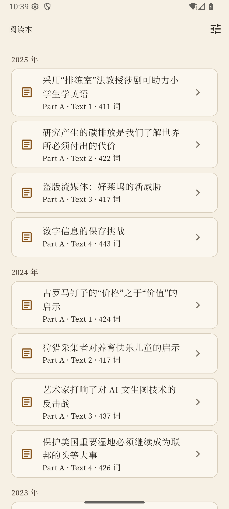
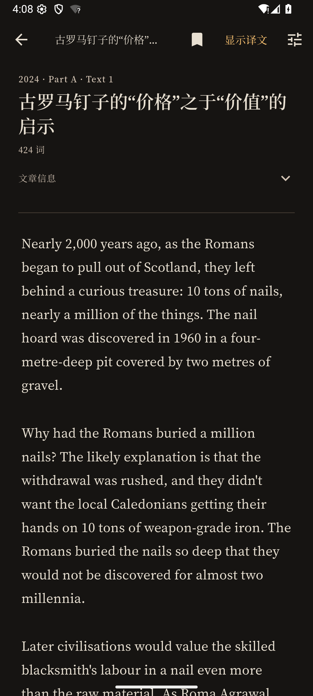

# 考研英语阅读本

[](https://github.com/Qxy0happy/reading-book/actions/workflows/ci.yml)
[](https://github.com/Qxy0happy/reading-book/actions/workflows/release.yml)

把考研英语一历年真题的阅读文章与资料译文整理成可离线阅读的 Flutter 应用（Android + Linux）。

当前仓库包含 **2004–2025 年 Part A 共 88 篇的真实英文正文与资料译文**；Part B/C 仍在实施中。





## 内容与版权

- `app/assets/content.sqlite` 包含 2004–2025 年 Part A 共 88 篇的英文正文、段落译文与句译文。
- 英文原文来自 Financial Times，中文译文来自黄皮书；版权归原权利人所有。仓库仅为个人学习与研究用途收录，不构成再分发许可。
- **代码**采用 MIT；**内容**不适用 MIT，详见 [COPYRIGHT.md](COPYRIGHT.md)。
- 权利人如希望移除内容，请通过 GitHub Issue 联系维护者。

## 目录

```
app/         Flutter 应用（Android + Linux）
pipeline/    Python + uv 内容流水线
content/     本地生成的内容库（不提交）
docs/        截图与说明
.github/     CI 与 Release workflow
```

## 构建应用

```bash
cd app
flutter pub get
flutter analyze
flutter test
flutter build linux --release
./build/linux/x64/release/bundle/readingbook
```

Android：

```bash
cd app
flutter build apk --release --split-per-abi
```

Android 构建需要 JDK 21。Gradle 默认使用 `JAVA_HOME`；也可以在本机 `~/.gradle/gradle.properties` 中设置：

```properties
org.gradle.java.home=/path/to/jdk-21
```

可选 release 签名：在 `app/android/key.properties` 中配置 `storeFile`、`storePassword`、`keyAlias`、`keyPassword`，并把 keystore 放到 `app/android/app/` 下。未配置时使用 debug 签名。

## 内容流水线

```bash
cd pipeline
uv sync --locked
uv run pytest
uv run readingbook-build          # 默认构建原创示例，不覆盖 app/assets/content.sqlite
uv run readingbook-validate
```

- 默认 manifest 是 `config/manifest.sample.yaml`，源文件是 `config/sample-source.md`，用于开发与测试；生成到 `content/content.sqlite`。
- 需要把构建结果复制到应用资源时，显式传入 `--app-assets ../app/assets/content.sqlite`。
- `config/manifest.yaml` 指向本地真实资料路径，供已购买资料的用户自行扩展。
- 流水线已实现 2004–2023 精讲册与 2024–2025 精编版的 Part A 抽取；Part B/C 仍在实施中。

## 发布

推送 `v*` tag 会触发 `.github/workflows/release.yml`，构建并发布：

- `reading-book-android-arm64-v8a.apk`
- `reading-book-linux-amd64-<version>.tar.gz`
- `SHA256SUMS`

也可以在 Actions 页面手动触发 Release workflow 并填写 tag。Linux 产物解压后运行 `bundle/readingbook`。

## 技术栈

- Flutter 3.50.1 / Dart 3.14
- drift + sqlite3 + path_provider
- Python 3.14 + uv + PyYAML
- Source Serif 4 + Noto Serif SC（SIL Open Font License 1.1）

## 许可证

代码采用 [MIT License](LICENSE)。字体采用 SIL Open Font License 1.1，许可证文本见 `app/assets/fonts/*-OFL.txt`。阅读内容的版权与使用边界见 [COPYRIGHT.md](COPYRIGHT.md)。
